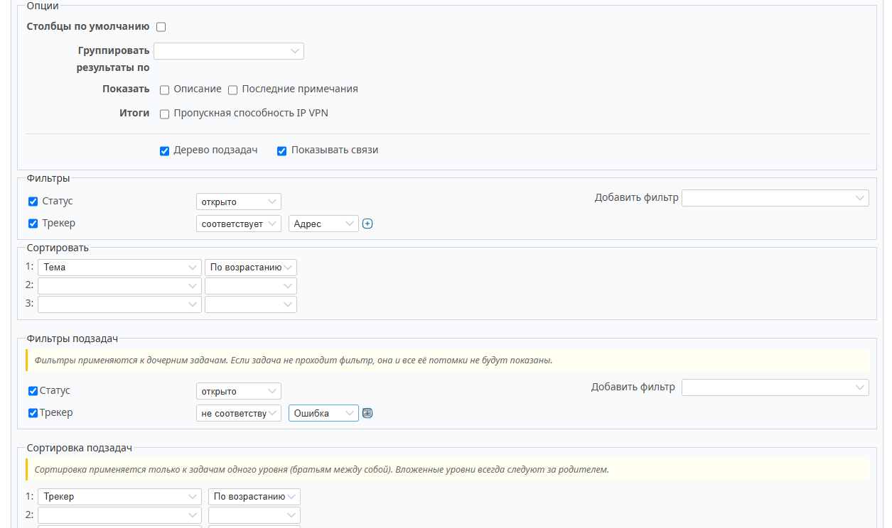
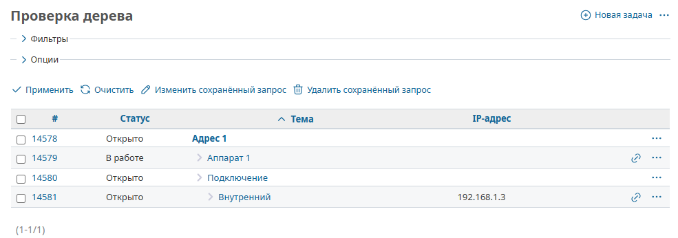
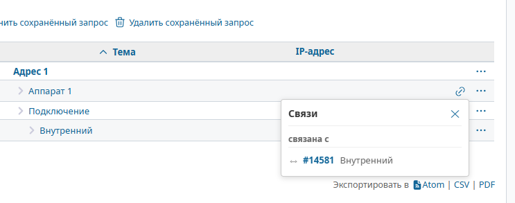

# Иерархия задач с сортировкой и связями (Redmine Hierarchy Sort)

Плагин для Redmine, обеспечивающий иерархическую сортировку задач с сохранением древовидной структуры и визуализацией связей между задачами.


## 📋 Описание

**Redmine Hierarchy Sort** расширяет стандартные возможности Redmine, позволяя:

- 🔹 **Сохранять иерархию задач** при любой пользовательской сортировке (по приоритету, дате, статусу и т.д.)
- 🔹 **Применять независимые фильтры** для корневых задач и их потомков
- 🔹 **Настраивать отдельную сортировку** для каждого уровня вложенности
- 🔹 **Визуализировать связи** между задачами через удобные всплывающие окна
- 🔹 **Работать с межпроектными связями** — потомки могут находиться в других проектах

### Основные возможности

#### Иерархическая сортировка
- Дочерние задачи всегда остаются внутри своих родительских задач
- Сортировка применяется к "братьям" (задачам одного уровня)
- Пагинация считается только по корневым задачам
- Поддержка неограниченной глубины вложенности

#### Фильтрация
- Два независимых блока фильтров: для корней и для потомков
- Если корневая задача не проходит фильтр — всё её поддерево скрывается
- Если потомок не проходит фильтр — он и все его потомки не показываются

#### Визуализация связей
- Иконка связей рядом с каждой задачей (если связи есть)
- Всплывающее окно с группировкой по типам связей
- Отображение обоих направлений связей (входящие/исходящие)
- Кликабельные номера связанных задач

## ️ Скриншоты

### Интерфейс настройки запроса



### Результат работы плагина



### Всплывающее окно связей



##  Установка

### Требования

- Redmine версии 5.0 или выше
- Ruby 2.7+
- База данных: MySQL, PostgreSQL или SQLite

### Установка из GitHub

1. Перейдите в директорию плагинов вашего Redmine:
   ```bash
   cd /path/to/redmine/plugins
   ```

2. Клонируйте репозиторий плагина:
   ```bash
   git clone https://github.com/selfauthor/redmine_hierarchy_sort.git
   ```

3. Перезапустите приложение Redmine:
   ```bash
   # Для Passenger
   touch /path/to/redmine/tmp/restart.txt
   
   # Для Puma/Unicorn
   sudo systemctl restart redmine
   ```

5. Очистите кэш Redmine (опционально, но рекомендуется):
   ```bash
   cd /path/to/redmine
   bundle exec rake tmp:cache:clear
   ```

### Проверка установки

После установки:
1. Откройте Redmine в браузере
2. Перейдите в раздел "Задачи" любого проекта
3. Нажмите "Новый запрос" или отредактируйте существующий
4. В блоке "Опции" должны появиться чекбоксы "Дерево подзадач" и "Показывать связи"

## 🚀 Использование

### Создание запроса с иерархической сортировкой

1. **Откройте форму запроса:**
   - Перейдите в раздел "Задачи" проекта
   - Нажмите "Новый запрос" или выберите существующий и нажмите "Редактировать"

2. **Настройте основные фильтры:**
   - В блоке "Фильтры" задайте условия для отбора задач
   - Например: Статус = "Открыт", Трекер = "Задача"

3. **Настройте сортировку корней:**
   - В блоке "Сортировать" выберите критерии для корневых задач
   - Например: Приоритет (по убыванию), Тема (по возрастанию)

4. **Включите иерархический режим:**
   - В блоке "Опции" отметьте чекбокс **"Дерево подзадач"**
   - После этого появятся два новых блока: "Фильтры подзадач" и "Сортировка подзадач"

5. **Настройте фильтры подзадач (опционально):**
   - Задайте условия, которым должны соответствовать дочерние задачи
   - Например: Статус ≠ "Закрыт" (чтобы скрыть закрытые подзадачи)
   - Если фильтр не задан — показываются все потомки

6. **Настройте сортировку подзадач (опционально):**
   - Выберите критерии сортировки для задач внутри каждой ветки
   - Например: Дата создания (по возрастанию)
   - Если сортировка не задана — используется сортировка по умолчанию

7. **Включите показ связей (опционально):**
   - В блоке "Опции" отметьте чекбокс **"Показывать связи"**
   - У задач, имеющих связи, появится иконка 🔗

8. **Сохраните запрос:**
   - Нажмите "Создать" или "Сохранить"
   - Запрос можно сохранить как личный или публичный

### Просмотр результатов

После сохранения запроса вы увидите:

- **Иерархическую структуру:** Корневые задачи отсортированы по заданным критериям, подзадачи вложены в родителей
- **Пагинацию по корням:** На странице отображается N корневых веток (например, 25), каждая со всеми своими потомками
- **Иконки связей:** Если включена опция "Показывать связи", у задач со связями появится иконка 

### Работа со связями

1. **Просмотр связей:**
   - Наведите курсор на иконку 🔗 — появится подсказка "Связи"
   - Кликните на иконку — откроется всплывающее окно

2. **Всплывающее окно связей:**
   - Связи сгруппированы по типам (Блокирует, Дублирует, Связана с и т.д.)
   - Каждый тип связи показан только если он есть у задачи
   - Направления связей обозначены иконками:
     - → Исходящая связь (текущая задача влияет на другую)
     - ← Входящая связь (другая задача влияет на текущую)
     - ↔ Равноправная связь (взаимная связь)
   - Кликните на номер задачи — перейдете к ней

3. **Закрытие окна:**
   - Нажмите крестик ✕ в правом верхнем углу
   - Или кликните в любое место вне окна

### Примеры использования

#### Пример 1: Просмотр активных задач с закрытыми подзадачами

**Сценарий:** Вы хотите видеть только открытые корневые задачи, но при этом показывать все их подзадачи (включая закрытые).

**Настройка:**
- Фильтры: Статус = "Открыт"
- Сортировка: Приоритет (по убыванию)
- ✅ Дерево подзадач
- Фильтры подзадач: (не заданы — показываются все)
- Сортировка подзадач: Статус (по возрастанию), Тема

**Результат:** Все открытые задачи отсортированы по приоритету, под каждой — все её подзадачи, отсортированные по статусу (сначала открытые, потом закрытые).

#### Пример 2: Мониторинг блокирующих задач

**Сценарий:** Вы хотите найти задачи, которые блокируют другие, и увидеть их связи.

**Настройка:**
- Фильтры: (не заданы — все задачи)
- Сортировка: ID (по убыванию)
- ✅ Дерево подзадач
- ✅ Показывать связи

**Результат:** Все задачи с их иерархией. У задач со связями "блокирует/блокируется" видна иконка 🔗. Клик показывает детали связей.

## ⚙️ Технические детали

### Архитектура плагина

```
redmine_hierarchy_sort/
├── init.rb                          # Инициализация плагина
├── config/
│   ── locales/
│       ├── ru.yml                   # Русская локализация
│       └── en.yml                   # Английская локализация
├── app/
│   ├── models/
│   │   ├── query_patch.rb           # Патч модели Query
│   │   └── issue_query_patch.rb     # Патч модели IssueQuery
│   ├── views/
│   │   ├── queries/
│   │   │   ├── _hierarchy_options.html.erb
│   │   │   ├── _child_filters.html.erb
│   │   │   └── _child_sort_criteria.html.erb
│   │   ── issues/
│   │       ├── _relation_icon.html.erb
│   │       └── _relation_popover.html.erb
│   └── helpers/
│       └── hierarchy_sort_helper.rb
├── lib/
│   └── redmine_hierarchy_sort/
│       ├── hierarchy_builder.rb     # Ядро алгоритма
│       ├── relation_loader.rb       # Загрузка связей
│       ├── query_options_serializer.rb
│       └── sql_builder.rb
├── assets/
│   ├── javascripts/
│   │   └── hierarchy_sort.js
│   └── stylesheets/
│       └── hierarchy_sort.css
└── test/
    ├── unit/
    └── functional/
```

### Алгоритм работы

1. **Анализ запроса:** Определение полей для фильтрации и сортировки
2. **Загрузка корней:** SQL-запрос с фильтрами и сортировкой, выбор только `id` и `parent_id`
3. **Определение относительных корней:** Удаление задач, чьи родители есть в выборке
4. **Пагинация:** Применение `limit` и `offset` к массиву корней
5. **Рекурсивная загрузка потомков:** Для каждого корня загружаются потомки с применением фильтров
6. **Финальная загрузка:** Загрузка полных объектов задач для отображения
7. **Рендеринг:** Отображение таблицы с иерархией и иконками связей

### Совместимость

- **Redmine:** 5.0, 5.1, 6.0
- **Ruby:** 2.7, 3.0, 3.1, 3.2
- **Базы данных:** MySQL 5.7+, PostgreSQL 12+, SQLite 3

### Безопасность при удалении

Если плагин будет удален:
- Все настройки хранятся в поле `options` таблицы `queries` в формате YAML
- Redmine игнорирует неизвестные ключи (`hierarchy_enabled`, `child_filters` и т.д.)
- Существующие запросы продолжают работать без ошибок
- Никаких миграций БД не требуется

## 🐛 Известные ограничения

1. **Производительность на больших выборках:** При отсутствии фильтров и большом количестве задач (10000+) первая загрузка может занять 1-2 секунды
2. **Экспорт в CSV/PDF:** Иерархическая структура не сохраняется при экспорте — задачи экспортируются плоским списком
3. **Группировка результатов:** Режим группировки (`group_by`) не совместим с иерархической сортировкой

## 🤝 Участие в разработке

Мы приветствуем вклад в развитие плагина! См. [CONTRIBUTING.md](CONTRIBUTING.md) для получения информации о том, как участвовать в разработке.

## 📄 Лицензия

Этот плагин распространяется под лицензией GNU General Public License v2.0. См. [LICENSE](LICENSE) для получения подробностей.

## 📧 Контакты

- **Автор:** [Андрей Якушев]
- **Email:** [info@a2ya.ru]
- **GitHub:** [https://github.com/selfauthor/redmine_hierarchy_sort](https://github.com/selfauthor/redmine_hierarchy_sort)

---

**Версия документа:** 1.0.0  
**Последнее обновление:** 2026-07-31
